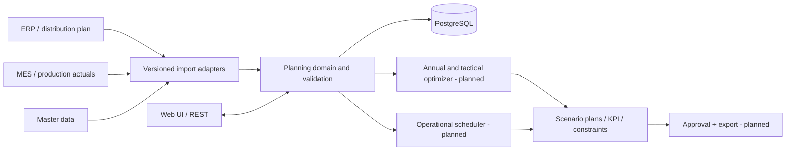

# Target architecture & current boundaries

## Context

Volume planning (annual & tactical) and operational scheduling share product and material reference data but have different aggregation and optimization constraints. A modular monolith is the starter architecture. Separate solvers and workers can be extracted after a real benchmark demonstrates a need.

All boxes marked `planned` are architecture goals; only `Web UI / REST`, `PostgreSQL`, limited validation, illustrative calculation and simple scenario/run storage are presently implemented.

## Components

| Component | Current implementation | Planned responsibility |
|---|---|---|
| UI | HTML/CSS/JS static SPA, FastAPI-hosted | RU/EN, timelines/Gantt, constraints editor, planning tables |
| API | FastAPI HTTP endpoints | RBAC, pagination, jobs, approval, export, reports |
| Domain | `app/schemas.py`, `app/planning.py` | Grade wheels, equipment calendars, balances, solver adapters |
| Persistence | PostgreSQL; Alembic | Versioned datasets, immutable runs, audit, approval state |
| Batch | Sync illustrative execution | Queue/worker, cancellation, timeout, solver reproducibility |
| Integration | None | Import/export, idempotent adapters, lineage and retention |

## Container deployment

`compose.yaml` builds **nothing** and references an image published by GitHub Actions to GHCR; this works with Portainer Stack **Git repository** deployments without requiring the Portainer host to compile Python source. Single `app` instance connects to `db`; the database is reachable only on an internal bridge network. Host port is bound to loopback by default. Database volume persists across stack updates.

For development, `compose.dev.yaml` performs a local `build: .` and uses disposable local credentials.

## Concurrency, migrations & resilience

Current startup invokes `alembic upgrade head` inside the application container and should have **one replica only**. Before HA, separate migration as an administratively controlled one-shot job, add connection limits, safe rollout rules, queues and backup/restore. Multiple app replicas now may race during migration; do not scale out yet.

## Solver direction (proposal, not a fact from requirements)

1. **Annual:** mixed integer optimization for volumes + changeover/grade-wheel sequence; 18-month time horizon. Keep hard capacity/material/storage restrictions inviolable; feasible shortfall with penalties if demand cannot be served.
2. **Tactical:** week buckets and inherited/fixed grade wheel. Optimize capacity and resource use with inventory and repair calendars.
3. **Operational:** day / shift / operation detail up to 28 days, schedule at equipment granularity, optionally high-fidelity simulator as a feasibility oracle if licensed/available.
4. Record input-data snapshot, solver version, time limit, objective and constraint breaches. Expose infeasible diagnostics rather than false precision.

The exact MILP/CP/simulation implementation, solver licensing, grade-wheel cost model and plant flows are **open design decisions**.
